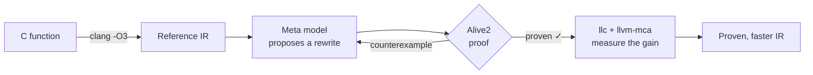

# qed-superopt

**An LLM finds faster code. A theorem prover makes sure it's right.**

`qed-superopt` is a superoptimizer for LLVM IR. A Meta model proposes rewrites of small, hot functions that beat `clang -O3`, and [Alive2](https://github.com/AliveToolkit/alive2) formally proves every rewrite correct, for **every possible input**. When a proposal is wrong, the prover returns a counterexample, the model repairs its attempt, and the loop continues. Nothing unproven ever reaches the output.

> *Quod erat demonstrandum*: what was to be shown, has been shown.

Built for the **Meta Global AI Developer Hackathon** (Oct 26 – Nov 4, 2026), theme *Push the Frontier*.

> [!NOTE]
> 🚧 Under active development during the hackathon.

---

## Why

Compilers are excellent, but not perfect. Every month, developers report *missed optimizations* to LLVM: code where `clang -O3` emits more instructions than necessary. Finding them by hand is slow, and checking that a clever rewrite is really correct is even slower, because the traps are subtle: signed overflow, shifts past the bit width, poison values.

LLMs are good at the first part: creative, plausible rewrites. They are terrible at the second: they hallucinate with confidence. So we split the job:

| | Creativity | Certainty |
|---|---|---|
| **LLM alone** | ✅ | ❌ |
| **Exhaustive search** (classic superoptimizers) | ❌ limited by search space | ✅ |
| **qed-superopt** | ✅ the LLM proposes | ✅ the prover decides |

## How it works



1. **Extract** a function's IR as produced by `clang -O3`: the baseline to beat.
2. **Propose**: a Meta model (Muse Spark via the Meta Model API) rewrites it.
3. **Prove**: Alive2 checks the rewrite against the original with an SMT solver (Z3). If it is wrong, Alive2 produces a concrete input that breaks it, which goes back to the model.
4. **Measure**: the proven rewrite is lowered to x86-64 assembly and scored with `llvm-mca` (Skylake), then timed on a real CPU.

## Quick start

You need [uv](https://docs.astral.sh/uv/) and the reference toolchain: LLVM `b974545` and Alive2 `adacbd5`, with Z3, in a `qed-toolchain` folder next to this repository (or set `QED_TOOLCHAIN`). Building LLVM takes hours:

```bash
mkdir ../qed-toolchain && cd ../qed-toolchain
git init llvm-project && cd llvm-project
git remote add origin https://github.com/llvm/llvm-project.git
git fetch --depth 1 origin b97454582dfbe2d5ebe7b7b1533de947bef16942 && git checkout FETCH_HEAD
cd ..
cmake -G Ninja -S llvm-project/llvm -B llvm-build -DCMAKE_BUILD_TYPE=Release \
  -DLLVM_ENABLE_PROJECTS="llvm;clang" -DLLVM_TARGETS_TO_BUILD="X86;AArch64" \
  -DLLVM_ENABLE_ASSERTIONS=ON -DLLVM_ENABLE_RTTI=ON -DLLVM_ENABLE_EH=ON -DBUILD_SHARED_LIBS=ON \
  -DLLVM_INCLUDE_TESTS=OFF -DLLVM_INCLUDE_BENCHMARKS=OFF -DLLVM_INCLUDE_EXAMPLES=OFF
ninja -C llvm-build
git clone https://github.com/AliveToolkit/alive2.git
git -C alive2 checkout adacbd5180ccf95075e9867c4f0c259f59c9fef2
cmake -G Ninja -S alive2 -B alive2/build -DCMAKE_BUILD_TYPE=Release -DBUILD_TV=1 \
  -DCMAKE_PREFIX_PATH=$PWD/llvm-build -DCMAKE_CXX_COMPILER=$PWD/llvm-build/bin/clang++
ninja -C alive2/build alive-tv
```

Then, from this repository, without any API key:

```bash
uv run pytest -q                                                     # includes the wrong rewrites that must be rejected
PYTHONPATH=. uv run python scripts/verify_all.py                     # re-proves every recorded result
PYTHONPATH=. uv run python scripts/fold_back.py results/spark-full-v1   # applies our rule to the recorded wins
```

To run the loop on one function, copy `.env.example` to `.env`, add a Meta Model API key, and cap the spending:

```bash
PYTHONPATH=. uv run python -m qed.loop bench/B/llvm-issue-215060 --run-id try-1 --max-total 1
```

## Why you can trust the results

A superoptimizer is only as good as its proofs, so rigor is the core of the project, not an afterthought.

- **What we prove is refinement**, the exact correctness criterion LLVM uses for its own optimizations: wherever the original function has defined behavior, the rewrite returns the same result, and it never introduces new undefined behavior. For example, `x + 1 > x` on a signed `int` may become `true`: the two only differ at `INT_MAX`, where the original overflows and is undefined.
- **Small trusted base**: Alive2, Z3, and LLVM's IR semantics. Neither the LLM nor our own Python code is trusted.
- **Strict reading of the prover**: only Alive2's exact success message counts. Timeouts, unsupported features and approximations count as *not proven*.
- **No sleight of hand**: the source is the untouched `clang -O3` output, the rewrite must keep the exact same signature, and every result is stored with the files that were proven and their hashes.
- **We test the tester**: a regression suite of deliberately wrong rewrites (`abs(INT_MIN)`, oversized shifts, introduced division by zero…) that the pipeline must reject, every time.
- **Reproducible**: one command (`scripts/verify_all.py`) re-checks the corpus and re-runs the prover on every recorded result, checking the stored hashes.
- **Honest numbers**: one pinned LLVM commit, same target CPU on both sides, gains measured on the final assembly rather than on the IR.
- **Measurement conditions**: `scripts/bench_cpu.py` times each win on the real CPU (i7-9700K, then i7-12700H) with the same inputs in a predictable and in a random order, turbo off, core frequency measured at the start and end of every launch, median of 201 repetitions, 5 separate launches, and records these conditions with the results. It runs under WSL2, which executes natively on the CPU (no emulation): the spread between launches and the branch-free wins, used as controls, check the noise. The median spread is 0.9% on both CPUs, but some measures are noisier: over 2% on 61 of 316 on the i7-9700K and on 138 of 316 on the i7-12700H. A win only counts if every launch clears the threshold, and the spread of each measure is in the results.

## Benchmark

We evaluate on a corpus of small, pure integer functions, in three groups reported separately:

| Group | What | Expected outcome |
|---|---|---|
| **Control** | Functions `clang -O3` already optimizes perfectly | Nothing found: no false wins |
| **Known misses** | Optimizations reported as missed in LLVM issues and prior work | Rediscover them |
| **Open** | Classic bit-manipulation functions written naively | New discoveries |

## Results

On the frozen corpus `corpus-v1`: 134 functions (24 control, 61 known misses, 49 open), up to 5 attempts each. Every win below is proven correct (refinement) by Alive2.

| | Muse Spark | LLM Compiler |
|---|---:|---:|
| Functions with a proven rewrite | 132 | 80 |
| Faster than `clang -O3`, gain estimated by `llvm-mca` | 105 | 30 |
| Kept: not undone by `opt -O3`, and over 5% in throughput or latency with neither worse | 79 | 22 |
| Confirmed on the i7-9700K | 60 | 15 |
| Confirmed on the i7-12700H | 59 | 10 |
| **Confirmed on both CPUs** | **51** | **8** |
| Cost | about $36.50, failed calls included | none: local, 57 min on a GPU |

Each kept win is timed on each CPU in four ways: called as a function and pasted inline in a loop, each with predictable and with random inputs. **Confirmed** means over 5% faster in every launch in at least one of the four, and slower in none (under 0.98 in every launch). Otherwise a win depends on the context, shows no clear gain, or is slower. We chose this rule after seeing the data, so the four numbers of every win are in [`results/bench-9700k/`](results/bench-9700k/) and [`results/bench-12700h/`](results/bench-12700h/).

Of the wins confirmed on both CPUs, Muse Spark has 39 known misses, 11 open functions and 1 control; LLM Compiler has 8 known misses. Some of these wins on open functions, as speedups over `clang -O3` on the i7-9700K:

| Function | Call, predictable | Call, random | Inline, predictable | Inline, random |
|---|---:|---:|---:|---:|
| `rgb565-to-rgb888` | 1.40x | 1.40x | 2.99x | 2.99x |
| `libcxx-days-from-civil` | 1.54x | 1.54x | 1.51x | 1.51x |
| `hex-digit-value` | 1.80x | 1.80x | 1.09x | 1.09x |
| `opus-silk-lin2log` | 1.33x | 2.36x | 1.35x | 2.43x |
| `fletcher16-update` | 1.14x | 1.14x | 1.21x | 1.21x |

**Controls.** `llvm-mca` kept 2 of the 24 controls, which were supposed to have nothing to gain. `rot-lr-xor` is no reliable gain: as a call and inline, 0.88x and 1.05x on the i7-9700K, but 1.12x and 0.96x on the i7-12700H. `align-up-pow2` shows a gain only inline, 1.14x and 1.11x, and about 1.00x as a call: it rediscovers a miss LLVM already tracks ([#125354](https://github.com/llvm/llvm-project/issues/125354)), so its control label looks wrong.

**What the feedback brings.** On 30 functions drawn at random, we compared independent attempts, feedback with the verdict only, and feedback with the counterexample: 16, 18 and 18 kept wins. Only 4 functions change between the first and the last, 3 against 1, which is no evidence that memory helps. Counterexamples are rare: 10 in the whole Muse Spark run, on 8 functions, and they changed no result. So far Alive2 works as a judge that guarantees what we keep, more than as a teacher.

**Limits.**
- Small pure integer functions, one pass per function, two CPUs. Timing runs under WSL2, where we cannot pin a physical core.
- The CPU matters: the verdict of 19 of Muse Spark's 79 kept wins differs between the two.
- `llvm-mca` alone is not enough: 26 of its 105 first wins fall to `opt -O3` or to our rule, and 28 of the remaining 79 are not confirmed on both CPUs.
- Wins with a branch often depend on the inputs: `median3-i32` is 6.11x inline with random inputs and 0.94x with predictable ones.
- The known solutions of 8 of the 61 known misses show no gain under our rule. We keep them in that group, since the corpus is frozen and no kept win comes from them.
- Nothing has been reported to LLVM yet, and we do not call any win new: a search of LLVM issues finds nothing on 4 candidates, which is weak evidence.

## What we built vs. what we use

Everything in this repository was written during the hackathon. We build on the shoulders of excellent open-source tools, which we call but do not modify:

| Built by us | Used as-is |
|---|---|
| The propose → prove → repair loop and its orchestration | [LLVM / clang](https://llvm.org) (Apache 2.0 with LLVM Exceptions) |
| Prompts and counterexample feedback | [Alive2](https://github.com/AliveToolkit/alive2) (MIT) and [Z3](https://github.com/Z3Prover/z3) (MIT) |
| The rigor layer: strict proof parsing, signature checks, verifier regression suite | Meta's Muse Spark model (and Muse Wonder, in experiments), via the Meta Model API |
| The benchmark corpus and its evaluation | Meta's LLM Compiler, run locally with [llama.cpp](https://github.com/ggml-org/llama.cpp) |
| Spending controls: hard cap per run, response cache | `llvm-mca` for performance estimates |
| Measurement harness (`scripts/bench_cpu.py`) and result checks (`scripts/fold_back.py`) | The `openai` Python client, only as the HTTP client of the Meta Model API (requests go to Meta, no OpenAI model is used) |

## Prior art

- **[Souper](https://github.com/google/souper)**: a superoptimizer for LLVM IR based on exhaustive, solver-driven search.
- **[STOKE](https://github.com/StanfordPL/stoke)**: stochastic search over x86-64 assembly.
- **AlphaDev** (DeepMind): reinforcement learning that discovered faster sorting routines.
- **Meta LLM Compiler**: LLMs trained on LLVM IR and assembly.

Our contribution: use an LLM as the *search heuristic*, feed the prover's verdicts back to it, and publish only what is formally proven.

## Team

- **Benoit** ([@benoithms](https://github.com/benoithms))
- **Jules** ([@julesreyn](https://github.com/julesreyn))

## License

[MIT](LICENSE)

Built with LLM Compiler.
