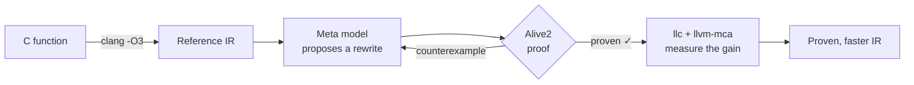

# qed-superopt

**An LLM finds faster code. A theorem prover makes sure it's right.**

`qed-superopt` is a superoptimizer for LLVM IR. A Meta model proposes rewrites of small, hot functions that beat `clang -O3`, and [Alive2](https://github.com/AliveToolkit/alive2) formally proves every rewrite correct, for **every possible input**. When a proposal is wrong, the prover returns a counterexample, the model repairs its attempt, and the loop continues. Nothing unproven ever reaches the output.

> *Quod erat demonstrandum*: what was to be shown, has been shown.

Built for the **Meta Global AI Developer Hackathon** (Oct 26 – Nov 4, 2026), theme *Push the Frontier*.

> [!NOTE]
> 🚧 Under active development during the hackathon. Results will be published here as they are proven.

---

## Why

Compilers are excellent, but not perfect. Every month, developers report *missed optimizations* to LLVM: code where `clang -O3` emits more instructions than necessary. Finding them by hand is slow, and checking that a clever rewrite is really correct is even slower, because the traps are subtle: signed overflow, shifts past the bit width, poison values.

LLMs are good at the first part: creative, plausible rewrites. They are terrible at the second: they hallucinate with confidence. So we split the job:

| | Creativity | Certainty |
|---|---|---|
| **LLM alone** | ✅ | ❌ |
| **Exhaustive search** (classic superoptimizers) | ❌ limited by search space | ✅ |
| **qed-superopt** | ✅ the LLM proposes | ✅ the prover decides |

## How it works

1. **Extract** a function's IR as produced by `clang -O3`: the baseline to beat.
2. **Propose**: a Meta model (Muse Spark via the Meta Model API) rewrites it.
3. **Prove**: Alive2 checks the rewrite against the original with an SMT solver (Z3). If it is wrong, Alive2 produces a concrete input that breaks it, which goes back to the model.
4. **Measure**: the proven rewrite is lowered to x86-64 assembly and scored with `llvm-mca` (Skylake). Confirmation with a microbenchmark on real hardware is in progress.

## Why you can trust the results

A superoptimizer is only as good as its proofs, so rigor is the core of the project, not an afterthought.

- **What we prove is refinement**, the exact correctness criterion LLVM uses for its own optimizations: wherever the original function has defined behavior, the rewrite returns the same result, and it never introduces new undefined behavior. For example, `x + 1 > x` on a signed `int` may become `true`: the two only differ at `INT_MAX`, where the original overflows and is undefined.
- **Small trusted base**: Alive2, Z3, and LLVM's IR semantics. Neither the LLM nor our own Python code is trusted.
- **Strict reading of the prover**: only Alive2's exact success message counts. Timeouts, unsupported features and approximations count as *not proven*.
- **No sleight of hand**: the source is the untouched `clang -O3` output, the rewrite must keep the exact same signature, and every result is stored with the files that were proven and their hashes.
- **We test the tester**: a regression suite of deliberately wrong rewrites (`abs(INT_MIN)`, oversized shifts, introduced division by zero…) that the pipeline must reject, every time.
- **Reproducible**: one command (`scripts/verify_all.py`) re-checks the corpus and re-runs the prover on every recorded result, checking the stored hashes.
- **Honest numbers**: one pinned LLVM commit, same target CPU on both sides, gains measured on the final assembly rather than on the IR.
- **Measurement conditions**: `scripts/bench_cpu.py` times each win on the real CPU (i7-9700K, then i7-12700H) with the same inputs in a predictable and in a random order, turbo off, core frequency measured at the start and end of every launch, median of 201 repetitions, 5 separate launches, and records these conditions with the results. It runs under WSL2, which executes natively on the CPU (no emulation): a spread under 2% between launches and the branch-free wins, used as controls, check that the noise stays small.

## Benchmark

We evaluate on a corpus of small, pure integer functions, in three groups reported separately:

| Group | What | Expected outcome |
|---|---|---|
| **Control** | Functions `clang -O3` already optimizes perfectly | Nothing found: no false wins |
| **Known misses** | Optimizations reported as missed in LLVM issues and prior work | Rediscover them |
| **Open** | Classic bit-manipulation functions written naively | New discoveries |

*Results coming soon.*

## What we built vs. what we use

Everything in this repository was written during the hackathon. We build on the shoulders of excellent open-source tools, which we call but do not modify:

| Built by us | Used as-is |
|---|---|
| The propose → prove → repair loop and its orchestration | [LLVM / clang](https://llvm.org) (Apache 2.0 with LLVM Exceptions) |
| Prompts and counterexample feedback | [Alive2](https://github.com/AliveToolkit/alive2) (MIT) and [Z3](https://github.com/Z3Prover/z3) (MIT) |
| The rigor layer: strict proof parsing, signature checks, verifier regression suite | Meta's Muse Spark model (and Muse Wonder, in experiments), via the Meta Model API |
| The benchmark corpus and its evaluation | Meta's LLM Compiler, run locally with [llama.cpp](https://github.com/ggml-org/llama.cpp) |
| Spending controls: hard cap per run, response cache | `llvm-mca` for performance estimates |
| Measurement harness and result reporting (in progress) | The `openai` Python client, only as the HTTP client of the Meta Model API (requests go to Meta, no OpenAI model is used) |

## Prior art

- **[Souper](https://github.com/google/souper)**: a superoptimizer for LLVM IR based on exhaustive, solver-driven search.
- **[STOKE](https://github.com/StanfordPL/stoke)**: stochastic search over x86-64 assembly.
- **AlphaDev** (DeepMind): reinforcement learning that discovered faster sorting routines.
- **Meta LLM Compiler**: LLMs trained on LLVM IR and assembly.

Our contribution: use an LLM as the *search heuristic*, steer it with the prover's counterexamples, and publish only what is formally proven.

## Team

- **Benoit** ([@benoithms](https://github.com/benoithms))
- **Jules** ([@julesreyn](https://github.com/julesreyn))

## License

[MIT](LICENSE)

Built with LLM Compiler.
